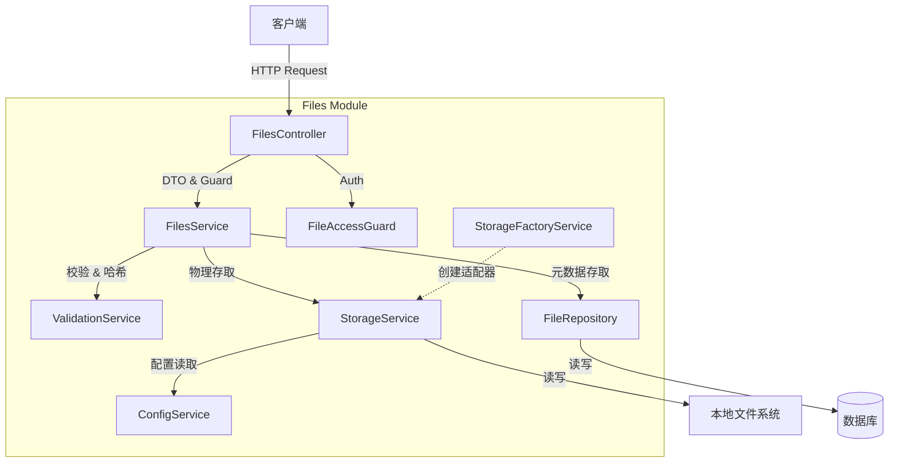
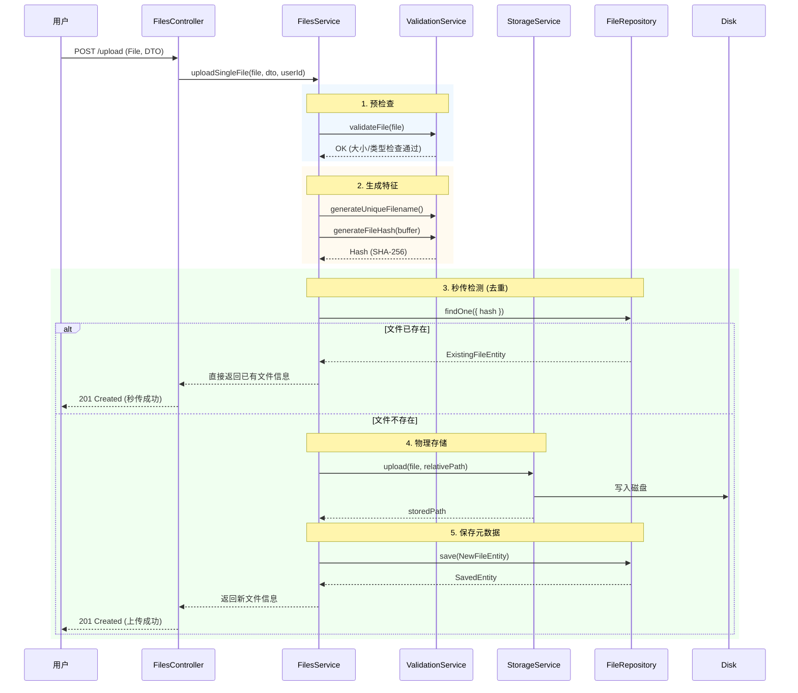
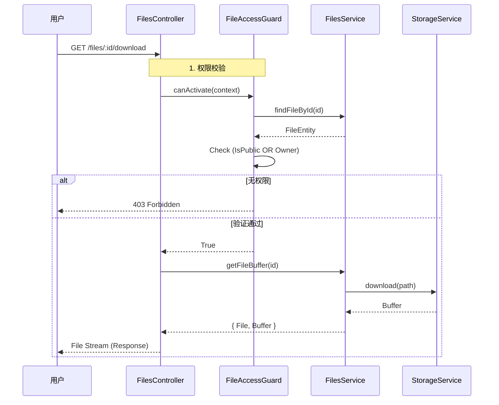

# 文件上传与管理模块 (src/shared/files)

本模块提供通用的文件上传、存储、访问控制与列表查询功能，开箱即用地支持本地文件系统存储、Multer 内存上传、Swagger 文档集成与权限校验。

## 📖 目录

- [功能概览](#功能概览)
- [系统架构与流程图](#系统架构与流程图)
- [代码执行流程详解](#代码执行流程详解)
- [API 接口说明](#api-接口说明)
- [关键配置](#关键配置)
- [快速集成](#快速集成)
- [数据库结构](#数据库结构)

## 功能概览

- **多模式上传**：支持单文件与批量上传（`multipart/form-data`）。
- **智能存储**：本地存储，自动按年月路径分组（`YYYY-MM/`），文件名唯一。
- **安全校验**：
  - 自动校验文件大小、MIME 类型。
  - 使用 `file-type` 基于二进制魔数进行真实文件类型检测。
- **极速秒传（去重）**：基于 SHA-256 哈希去重，同内容文件只存一份，秒级返回。
- **细粒度权限**：
  - **公开文件**：任何人可访问。
  - **私有文件**：仅上传者（所有者）可读写删。
- **全能检索**：支持分页、类型筛选、关键词搜索、多维度排序。
- **Swagger 集成**：完整的接口文档与在线调试支持。

## 系统架构与流程图

### 1. 模块架构图

以下展示了各个服务之间的依赖关系与职责划分：



### 2. 单文件上传流程 (Sequence Diagram)

展示了从接收请求到完成存储的完整时序，包含校验与去重逻辑：



### 3. 文件下载/预览流程



## 代码执行流程详解

### 1. 文件上传 (`uploadSingleFile`)

代码位置：`src/shared/files/services/files.service.ts`

1.  **入参接收**：`FilesController` 通过 `@UploadedFile()` 接收 `Multer` 处理后的内存文件对象。
2.  **安全校验**：
    - 调用 `ValidationService.validateFile()`。
    - 检查 `file.size` 是否超过配置限制。
    - 使用 `file-type` 库检测 `buffer` 的真实 MIME 类型，防止后缀名伪造。
    - 验证 MIME 类型是否在白名单中。
3.  **哈希计算**：
    - 调用 `ValidationService.generateFileHash()` 计算 SHA-256 值。
4.  **去重逻辑 (Deduplication)**：
    - 查询数据库是否存在相同 `hash` 的记录。
    - **如果存在**：直接返回数据库中的记录，**不进行磁盘写入**，实现“秒传”。
    - **如果不存在**：继续后续步骤。
5.  **物理存储**：
    - 生成唯一文件名（时间戳+随机串）。
    - 规划存储路径（例如 `2024-05/filename.png`）。
    - 调用 `StorageService.upload()` 将 Buffer 写入磁盘。
6.  **元数据落库**：
    - 创建 `File` 实体，记录原始文件名、MIME、大小、存储路径、哈希值、上传者 ID 等。
    - 保存到数据库。

### 2. 文件访问控制 (`FileAccessGuard`)

代码位置：`src/shared/files/guards/file-access.guard.ts`

该守卫用于 `GET /:id`、`download`、`preview` 等接口。

1.  **获取上下文**：从 Request 中解析 `user` 对象和路径参数 `id`。
2.  **查询文件**：调用 Service 查询文件元数据。
3.  **权限判断**：
    - **Rule 1**: 如果 `file.isPublic === true`，允许访问。
    - **Rule 2**: 如果 `file.userId === currentUser.id`，允许访问。
    - **Rule 3**: 否则，抛出 `403 Forbidden`。

## API 接口说明

| 方法       | 路径                  | 描述         | 关键参数                            |
| :--------- | :-------------------- | :----------- | :---------------------------------- |
| **POST**   | `/files/upload`       | 单文件上传   | `file`, `isPublic`, `description`   |
| **POST**   | `/files/upload/batch` | 批量上传     | `files[]` (Max 10)                  |
| **GET**    | `/files`              | 文件列表查询 | `current`, `size`, `type`, `search` |
| **GET**    | `/files/:id`          | 获取详情     | `id` (UUID)                         |
| **GET**    | `/files/:id/download` | 下载文件     | `Content-Disposition: attachment`   |
| **GET**    | `/files/:id/preview`  | 预览文件     | `Content-Disposition: inline`       |
| **DELETE** | `/files/:id`          | 删除文件     | 仅所有者可删                        |

## 关键配置

配置位于 `src/config` 或环境变量中：

- `NEST_UPLOAD_MAX_SIZE`: 单个文件大小限制（默认 10MB）。
- `NEST_UPLOAD_ALLOWED_TYPES`: 允许的 MIME 类型列表（空则不限制）。
- `NEST_UPLOAD_MAX_FILES`: 批量上传最大数量（默认 10）。
- `NEST_STATIC_UPLOAD_PATH`: 物理存储根目录（默认 `./static/uploads`）。

## 快速集成

1. **引入模块**：
   在 `AppModule` 或其他模块中导入：

   ```typescript
   @Module({
     imports: [FilesModule],
   })
   export class AppModule {}
   ```

2. **数据库同步**：
   确保 TypeORM 实体已同步，将自动创建 `files` 表。

3. **静态资源配置**：
   确保 `main.ts` 或 `app.module.ts` 中配置了静态资源服务，以便可以通过 URL 直接访问公开文件（如果需要）。

## 数据库结构

主要字段说明 (`entities/file.entity.ts`)：

- `id`: UUID，主键。
- `hash`: SHA-256，唯一索引（用于去重）。
- `path`: 磁盘相对路径（如 `2024/01/abc.png`）。
- `isPublic`: Boolean，是否公开。
- `userId`: 上传用户 ID（为空则为匿名上传）。
- `fileType`: 枚举（IMAGE, VIDEO, DOCUMENT 等），用于快速筛选。
